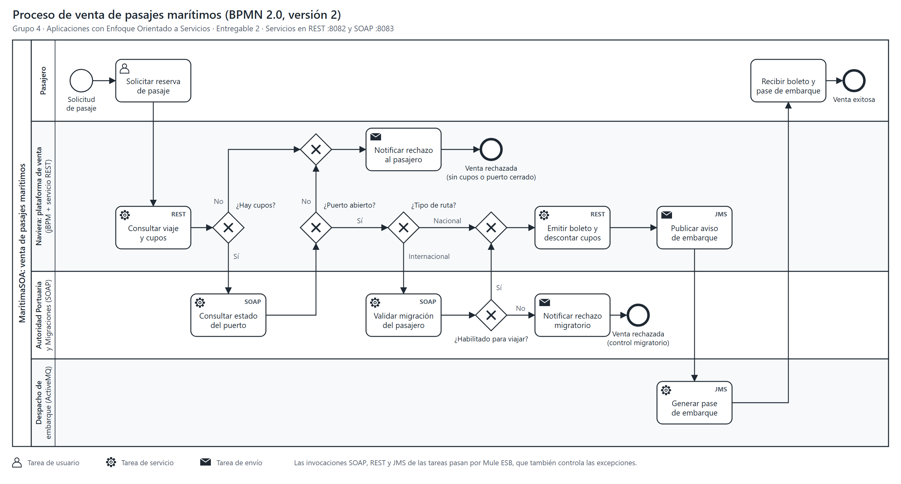

# MaritimaSOA

Sistema integrado de venta de pasajes marítimos nacionales e internacionales.
Proyecto integrador del curso **Aplicaciones con Enfoque Orientado a Servicios** (Grupo 4).

## Integrantes

| Integrante | Rol | Carpeta a su cargo |
| --- | --- | --- |
| Albornoz Hinostroza, Jatniel | Arquitecto de procesos (BPMN y jBPM) | `docs/bpmn/`, `jbpm/` |
| Marcelo Rodriguez, Fabian | Desarrollador de servicios (SOAP y REST) | `servicio-soap/`, `servicio-rest/` |
| Vargas Zapata, Renzo | Especialista de integración y pruebas (Mule ESB, ActiveMQ y MUnit) | `mule-esb/` |

## El caso

Una naviera vende pasajes en rutas nacionales (cabotaje) e internacionales (ferris y cruceros). Cada solicitud recorre cinco pasos:

1. **Solicitud de reserva.** El pasajero indica su documento o pasaporte, el código de viaje y la cantidad de asientos.
2. **Consulta de viaje y cupos (REST).** Se obtiene el tipo de ruta, el puerto de origen, los cupos y el precio.
3. **Control portuario y migratorio (SOAP).** Toda ruta verifica que el puerto esté abierto. Solo la ruta internacional valida pasaporte e impedimento de salida.
4. **Emisión del boleto (REST).** Si las validaciones pasan, se descuentan los cupos y se emite el boleto. Si no, se rechaza informando la causa.
5. **Notificación de embarque (ActiveMQ).** El boleto se publica en la cola `cola.embarque.boletos` para generar el pase de embarque.

## Diagrama BPMN



El archivo fuente es [docs/bpmn/venta-pasajes-maritimos.bpmn](docs/bpmn/venta-pasajes-maritimos.bpmn) (BPMN 2.0). Se puede abrir y editar en [bpmn.io](https://demo.bpmn.io) o en Camunda Modeler.

## Componentes

| Componente | Qué hace |
| --- | --- |
| jBPM | Ejecuta el proceso BPMN y evalúa las compuertas. |
| Mule ESB | Bus de integración: endpoint HTTP único, enrutamiento a SOAP y REST, control de excepciones y publicación en ActiveMQ. |
| `AutoridadPortuariaService` (SOAP) | Simula a Capitanía de Puerto y Migraciones. |
| `NavieraReservasAPI` (REST) | Sistema de la naviera: viajes, cupos y boletos. |
| Apache ActiveMQ | Cola `cola.embarque.boletos`. |

## Servicios

### SOAP: `AutoridadPortuariaService`

| Operación | Entrada | Salida |
| --- | --- | --- |
| `consultarEstadoPuerto` | `codigoPuerto`, `fechaZarpe` | `puertoAbierto`, `condicionMaritima`, `codigoAutorizacionZarpe` |
| `validarMigracionPasajero` | `numeroPasaporte`, `documentoIdentidad`, `paisDestino` | `habilitadoViaje`, `pasaporteVigente`, `impedimentoSalida`, `mensajeControl` |

### REST: `NavieraReservasAPI`

| Método y ruta | Entrada | Salida |
| --- | --- | --- |
| `GET /api/viajes/{codigoViaje}` | `codigoViaje` en la ruta | `codigoViaje`, `origen`, `destino`, `paisDestino`, `tipoRuta`, `codigoPuerto`, `fechaZarpe`, `cuposDisponibles`, `precioUnitario` |
| `POST /api/boletos` | `codigoViaje`, `documentoPasajero`, `nombrePasajero`, `tipoRuta`, `cantidadAsientos`, `codigoAutorizacionZarpe` | `idBoleto`, `codigoViaje`, `estado`, `montoTotal`, `muelleEmbarque`, `fechaEmision` |
| `GET /api/boletos/{idBoleto}` | `idBoleto` en la ruta | Detalle del boleto y su estado |

## Estructura del repositorio

```
maritima-soa/
├── README.md
├── docs/bpmn/        Diagrama BPMN (.bpmn, .png, .svg)
├── jbpm/             Proceso en jBPM            (Entregable 3)
├── servicio-soap/    AutoridadPortuariaService  (Entregable 2)
├── servicio-rest/    NavieraReservasAPI         (Entregable 2)
└── mule-esb/         Flujo Mule y pruebas MUnit (Entregable 3)
```

## Herramientas del curso

- Java JDK 8 y Maven
- Anypoint Studio 6.6 con Mule Runtime 3.9 CE, y Mule StandAlone
- Apache ActiveMQ
- jBPM (instalador con Eclipse)
- SoapUI y Postman para las pruebas

## Cómo ejecutar

Pendiente.
